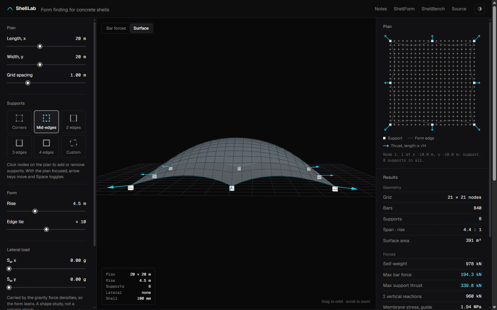

# ShellLab

Live force-density form finding for compression shells, in the browser. Set a plan, the supports, the rise and a sideways load; read the member forces, the thrust at each support, and the concrete and A1–A3 carbon it takes.

[](https://github.com/syednafizreja/parametric-canopy-carbon-optimization/actions/workflows/test.yml)

[Open ShellLab](https://syednafizreja.github.io/parametric-canopy-carbon-optimization/) | [ShellForm](https://github.com/syednafizreja/ShellForm) | [ShellBench](https://github.com/syednafizreja/ShellBench) | [Portfolio](https://syednafizreja.github.io/)

<picture>
  <source media="(prefers-color-scheme: light)" srcset="docs/screenshot-light.png">
  
</picture>

## The question

What shape carries its own weight in pure compression, and what does that shape ask of its supports? A funicular shell has no bending under self-weight, which is why it can be thin. ShellLab makes the shape a thing you can push around: change where it rests and the form, the forces and the thrust follow at once.

## What it does

- **Any rectangular plan**, from 6 to 40 m a side, with a grid of up to 41 × 41 nodes.
- **Supports** from presets (corners, corners and mid-edges, two edges, three edges, all edges) or placed by clicking nodes on the plan. The plan also works from the keyboard.
- **Form controls**: rise, and the free-edge tie (the force-density factor on the perimeter bars that keeps unsupported edges from pulling in).
- **Lateral load** in x and y, as a fraction of g. The same force densities carry it, so the form leans; this is the shape a seismic case pushes towards, not a seismic check.
- **Results**: bar forces (colour and legend), horizontal thrust at every support, vertical reactions, a live equilibrium residual, concrete volume and A1–A3 carbon with a ±25 % band.
- **Export** the form as JSON (inputs, nodes, bars, forces, reactions, results) or OBJ, and copy a link that holds the whole design.
- Dark by default with a light theme, no build step and no CDN, keyboard and screen-reader friendly, and laid out for a 390 px phone.

This repository was `parametric-canopy-carbon-optimization`; the earlier canopy study is kept at the tag [`canopy-archive`](https://github.com/syednafizreja/ShellLab/tree/canopy-archive).

## Method

The plan is a pin-jointed grid. For fixed force densities *q* = *N*/*L* (negative for compression), equilibrium at the free nodes is linear in the coordinates (Schek 1974):

$$
\mathbf{C}_f^{\mathsf T}\mathbf{Q}\,\mathbf{C}_f\,\mathbf{x}_f = \mathbf{p}_f - \mathbf{C}_f^{\mathsf T}\mathbf{Q}\,\mathbf{C}_x\,\mathbf{x}_x
$$

With every *q* < 0 the matrix is negative definite, so ShellLab solves it with a banded Cholesky factorisation; a 41 × 41 grid takes about 30 ms. The force densities are scaled once so the gravity form reaches the set rise, then reused with the lateral load, exactly as ShellForm's `form_to_rise` does.

Self-weight is surface area × thickness × 25 kN/m³, spread equally over the nodes. The form does not depend on that scale, so each bar force is its unit-weight force times the node weight. Reactions balance the free-node loads.

Carbon is concrete only: volume × 340 kgCO₂e/m³ for C40, the factor in [ShellBench v1.0.0](https://github.com/syednafizreja/ShellBench/blob/v1.0.0/data/carbon_factors.csv) (GB/T 51366-2019, Table D.0.1, C40 interpolated between C30 and C50). The ±25 % band is the one ShellForm uses.

## What it does not do

ShellLab finds forms; it does not design shells. It does not size the thickness, check buckling, check bending under non-funicular loads (wind, point loads, uneven snow), add reinforcement, or design supports and ties. The stress shown is bar force over its strip of shell, for orientation only. For sized and checked designs, see the 168 shells in the [ShellForm explorer](https://syednafizreja.github.io/ShellForm/explorer/).

## Verification

The solver in [`src/fdm.js`](src/fdm.js) is a port of ShellForm's `formfind.py` and `checks.py`, generalised to rectangles and any support set. [`tools/make_fixtures.py`](tools/make_fixtures.py) runs ShellForm itself (v0.2.0-6-g8e83d50) on six square cases (edge- and corner-supported, with and without lateral load, plus the free-edge inset search) and writes the results to [`test/fixtures/`](test/fixtures/). The tests check that:

- the edge order, supports, plan grid and force densities match ShellForm exactly;
- the coordinates match to 1 × 10⁻⁹ m (the largest difference found is 9.4 × 10⁻¹⁴ m);
- support reactions match to 1 × 10⁻⁸;
- every form is in equilibrium to a relative residual below 10⁻⁹ (ShellForm's test S2);
- a rectangular vault is symmetric, vertical reactions sum to the free-node weight, and an unsupported grid is reported, not solved.

```bash
npm test                 # Node 20 or later, no dependencies
python -I tools/make_fixtures.py ../ShellForm   # regenerate fixtures (needs ShellForm's environment)
```

The tests run on every push.

## Run it locally

No build step. Serve the folder with any static server, for example `npx http-server .`, and open the page. three.js r187 and the Geist fonts are vendored in [`vendor/`](vendor/), so nothing is fetched from a CDN.

## Related projects

- [ShellForm](https://github.com/syednafizreja/ShellForm): gravity-only versus seismic-aware form finding of concrete shells, with 168 sized designs and their carbon. ShellLab's solver comes from here.
- [ShellBench](https://github.com/syednafizreja/ShellBench): a carbon benchmark for reinforced concrete structures; the source of ShellLab's carbon factor.

## Citation

See [`CITATION.cff`](CITATION.cff). Author: Syed Nafiz Reja Hasib, ORCID [0009-0002-7162-7890](https://orcid.org/0009-0002-7162-7890).

Schek, H.-J. (1974). The force density method for form finding and computation of general networks. *Computer Methods in Applied Mechanics and Engineering*, 3(1), 115–134. https://doi.org/10.1016/0045-7825(74)90045-0

## Licence

MIT, see [`LICENSE`](LICENSE). three.js is MIT ([`vendor/three/LICENSE`](vendor/three/LICENSE)); Geist and Geist Mono are under the SIL Open Font License 1.1 ([`vendor/fonts/LICENSE-OFL.txt`](vendor/fonts/LICENSE-OFL.txt)).
